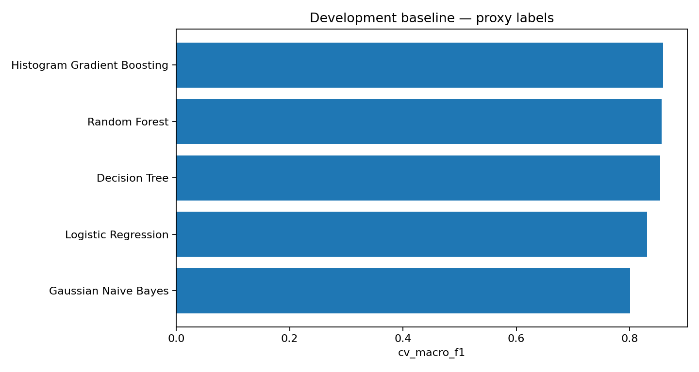
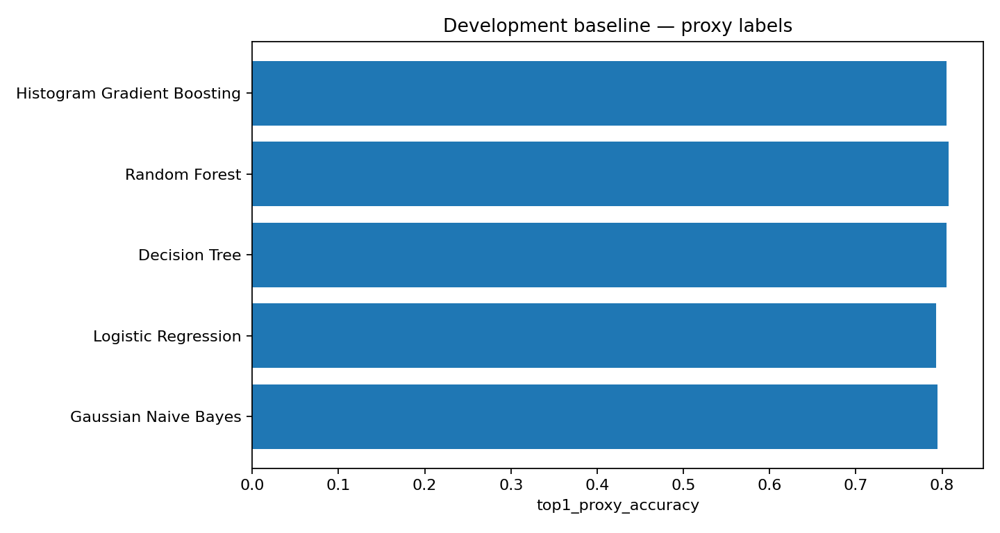

# PathSnap — Distributed GPS Map-Matching

PathSnap reconstructs vehicle trajectories from noisy GPS observations using a tuned Histogram Gradient Boosting classifier, directed HMM/Viterbi decoding, FastAPI and an interactive Folium dashboard.

**Status:** Real-data development completed, all ten student-testing API requests passed, independent two-laptop deployment demonstrated, and a combined dashboard provided for the two separate testing partitions. Final reserved-trip performance is not reported here.

## Architecture


## Dataset and features

The organiser-supplied data is divided into 80 training trips, 10 student-testing trips and 10 reserved evaluator trips. Each trip contains whitespace-delimited .track (longitude, latitude, timestamp), .nodes (road coordinates), .arcs (directed road edges) and .route (reference arc sequence) files.

GPS observations are filtered for invalid values, sorted chronologically and projected into a local UTM coordinate system. A Shapely STRtree selects the five nearest candidate road segments per observation.

Seven features are used: distance to segment, bearing difference, vehicle speed, arc length, projection fraction, timestamp gap and candidate rank.

Reference labels are nearest-reference-segment proxies, not independently verified GPS-fix labels. References do not enter the prediction features. Reserved data must not be used for development, training, optimisation or model selection.

## Five-model comparison

Development results, five-fold GroupKFold cross-validation grouped by trip:

| Model | CV Macro F1 | Candidate accuracy | Student Macro F1 | Top-1 proxy accuracy | Fit time (s) |
| --- | ---: | ---: | ---: | ---: | ---: |
| Logistic Regression | 83.11% | 90.38% | 84.48% | 79.32% | 1.20 |
| Gaussian Naive Bayes | 80.11% | 84.47% | 79.46% | 79.47% | 0.11 |
| Decision Tree | 85.36% | 91.90% | 87.28% | 80.48% | 8.14 |
| Random Forest | 85.63% | 92.09% | 87.36% | 80.74% | 34.31 |
| Histogram Gradient Boosting | 85.90% | 91.94% | 87.22% | 80.47% | 3.28 |

Histogram Gradient Boosting was selected by highest mean training-trip CV Macro F1 and favourable runtime relative to Random Forest. Random Forest slightly leads the original student-testing candidate accuracy and Top-1 proxy accuracy.





See [baseline results](results/official_baseline/model_comparison.csv), [fold scores](results/official_baseline/cv_folds.csv), and [plots and confusion matrices](results/official_baseline/).

## Bayesian optimisation

Optuna TPE, 15 trials with five-fold trip-grouped CV, seed 42. Best trial: 12 (zero-based).

| Hyperparameter | Selected value |
| --- | ---: |
| Maximum iterations | 160 |
| Learning rate | 0.055110 |
| Maximum leaf nodes | 23 |
| Minimum samples per leaf | 80 |
| L2 regularisation | 4.932771 |

| Metric | Untuned | Tuned |
| --- | ---: | ---: |
| CV Macro F1 | 85.90% | 86.00% |
| Candidate accuracy | 91.94% | 92.01% |
| Student Macro F1 | 87.22% | 87.33% |
| Top-1 proxy accuracy | 80.47% | 80.56% |
| Candidate log loss | 0.1861 | 0.1846 |
| Direct route continuity | 89.93% | 89.89% |

See [tuned comparison](results/official_tuning/tuned_comparison.csv) and [saved model configuration](artifacts/official_tuning/configuration.json). Full trial-history CSV verification remains outstanding.

## HMM and Viterbi

Candidate probabilities are used as emission scores. Directed hop-based transition potentials encourage connected routes. Viterbi finds the highest-scoring candidate sequence with backtracking; time gaps greater than 60 seconds or nonpositive gaps reset the sequence. The fixed decoder uses beta 0.5, a four-hop limit and disconnected-transition penalty 12.

| Student-testing metric | Classifier only | HMM + Viterbi |
| --- | ---: | ---: |
| Pointwise proxy accuracy | 80.56% | **84.06%** |
| Direct route continuity | 89.89% | **95.36%** |
| Mean sequence overlap F1 | 59.99% | **73.95%** |
| Mean ordered sequence similarity | 59.69% | **73.95%** |
| Total measured inference time (s) | 0.1475 | 0.7374 |

See [HMM comparison](results/official_hmm/hmm_comparison.csv) and [decoder configuration](results/official_hmm/decoder_config.json). All ten student-testing API requests passed; this is an execution pass count, not 100% prediction accuracy.

## Repository structure

```text
pathsnap_real_training.py   # Prepare features and train five models
pathsnap_real_tune.py       # Bayesian optimisation
pathsnap_real_hmm.py        # Directed Viterbi and development evaluation
pathsnap_real_map.py        # Student-testing analysis map
pathsnap_real_api.py        # Student-testing API
pathsnap_real_ui.html       # Student-testing standalone UI
pathsnap_evaluator_api.py   # Reserved evaluation API
pathsnap_evaluator_ui.html  # Reserved evaluation standalone UI
pathsnap_combined_ui.html   # Both partitions through one frontend
artifacts/                  # Trained models and configurations
results/                    # Actual development metrics and figures
requirements.txt
src/                        # Earlier supporting implementation
notebooks/                  # Earlier exploration and practice notebooks
deployment/                 # Earlier practice prototype
```

Use the root-level real-data scripts for development. The earlier synthetic practice experiments are not the official baseline.

## Install on Laptop 1 (model server)

```bash
git clone https://github.com/yashwanth00000/ML-Hackathon-PathSnap-TEAM_121_C-E.git
cd ML-Hackathon-PathSnap-TEAM_121_C-E
python3 -m venv .venv
source .venv/bin/activate
python -m pip install -r requirements.txt
```

On Windows, open PowerShell or Command Prompt in the extracted project folder. Create the virtual environment once, then install the dependencies with the saved model's scikit-learn version:

```powershell
python -m venv .venv
.\.venv\Scripts\python.exe -m pip install -r requirements.txt scikit-learn==1.6.1
```

If `.venv` already works, reuse its Python executable. Stop any APIs using that environment before recreating it, since Windows can lock the executable while it is running.

Place the organiser-provided data locally, preserving trip IDs with leading zeros:

```text
data/
  train/<trip_id>/<trip_id>.track, .nodes, .arcs, .route
  student_test/<trip_id>/<trip_id>.track, .nodes, .arcs, .route
  evaluator_test/<trip_id>/<trip_id>.track, .nodes, .arcs, .route
```

Each extension denotes a separate file named after its trip ID. The dataset and derived feature caches are excluded from GitHub. The tuned weights are included, so **retraining is not necessary for deployment**. Use a compatible scikit-learn environment; dependency ranges are not a complete environment lock.

### Start both APIs

In separate terminals at the repository root:

```bash
source .venv/bin/activate
python -m uvicorn pathsnap_real_api:app --host 0.0.0.0 --port 8002
```

When faculty authorises final evaluation:

```bash
source .venv/bin/activate
python -m uvicorn pathsnap_evaluator_api:app --host 0.0.0.0 --port 8003
```

| API | Port | Dataset |
| --- | ---: | --- |
| Student-testing API | 8002 | 10 development trips |
| Final evaluator API | 8003 | 10 reserved trips |
| Independent combined frontend | 8083 | Select either partition |

On Windows, start the student-testing API with:

```powershell
.\.venv\Scripts\python.exe -m uvicorn pathsnap_real_api:app --host 0.0.0.0 --port 8002
```

When faculty authorises final evaluation, start the evaluator API in a separate terminal:

```powershell
.\.venv\Scripts\python.exe -m uvicorn pathsnap_evaluator_api:app --host 0.0.0.0 --port 8003
```

Both APIs use the same frozen model and decoder. The evaluator API computes aggregate metrics after inference; reference labels remain server-side and are not returned to the client. Do not tune or select models based on reserved-trip results.

Obtain the current Mac Wi-Fi IP address:

```bash
ipconfig getifaddr en0
```

## Laptop 2 — Combined dashboard

For a browser-only setup, open `http://<LAPTOP_1_IP>:8002/ui` for student testing or `http://<LAPTOP_1_IP>:8003/ui` for final evaluation. Replace the placeholder with Laptop 1's Wi-Fi IPv4 address. The selected dashboard connects to its API automatically, and Laptop 2 needs only a browser. Both laptops must be on a network that allows communication between them.

To switch datasets through a single dashboard, use the combined dashboard setup below.

Copy [pathsnap_combined_ui.html](pathsnap_combined_ui.html) into a dedicated folder on Laptop 2. The client needs neither the model nor the dataset.

Navigate to that folder and start a local frontend server.

Windows PowerShell:

```powershell
py -m http.server 8083 --bind 127.0.0.1
```

macOS/Linux:

```bash
python3 -m http.server 8083 --bind 127.0.0.1
```

1. Connect both laptops to the same trusted network.
2. Open `http://localhost:8083/pathsnap_combined_ui.html` on Laptop 2.
3. Enter the current Laptop 1 address, for example `http://<LAPTOP_1_IP>:8002` (replace the placeholder).
4. Choose Student testing or Final evaluator. The dashboard switches API ports automatically.
5. Click **Connect**, select a trip, then click **Predict route**. Use the reserved partition only during authorised evaluation.

The dashboard shows GPS observations, classifier and HMM predictions, a Folium map, proxy accuracy, continuity, sequence metrics and prediction latency. Dataset switching clears old predictions and fetches the selected partition's trip list dynamically.

Troubleshooting: check the current server IP, listening ports and network; open the frontend through localhost:8083 instead of a file URL. CORS permits localhost:8083 and 127.0.0.1:8083. Keep these unauthenticated APIs on a trusted local network.

## API endpoints (both ports)

| Method | Path | Purpose |
| --- | --- | --- |
| GET | `/` | Health and model information |
| GET | `/trips` | Available trip IDs for that partition |
| GET | `/predict/{trip_id}` | Dynamic prediction and server-side metrics |
| GET | `/map/{trip_id}` | Interactive Folium map |
| GET | `/ui` | Partition-specific dashboard |
| GET | `/docs` | Swagger API documentation |

## Reproduce development experiments

Run only on the permitted development partitions from the project root:

```bash
python -u pathsnap_real_training.py prepare
python -u pathsnap_real_training.py train
python -u pathsnap_real_tune.py
python -u pathsnap_real_hmm.py
python -u pathsnap_real_map.py
```

The analysis map includes reference overlays for student-testing analysis only; the live dashboard does not expose reference labels. External basemap tiles may require internet access.

## Limitations and remaining obligations

- Nearest-reference labels are provisional pointwise proxies; candidate accuracy, route proxy accuracy and continuity are different measures.
- The fixed decoder does not guarantee a complete connected route or insert skipped intermediate arcs.
- Complete Bayesian trial history and environment versions need verification; earlier numerical warnings have not been comprehensively resolved.
- Final evaluator-trip results are not claimed here. Complete authorised evaluation and the technical report.
- AI assistance was used for code, troubleshooting and documentation. The team is responsible for understanding the implementation and following event disclosure and academic integrity rules.
